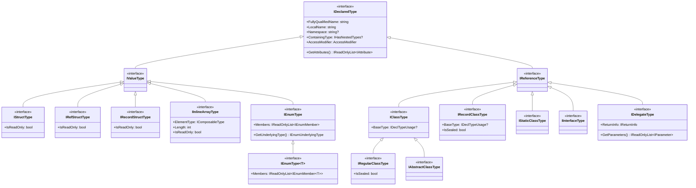

```mermaid
classDiagram
    class ITypeUsage_TKind_["ITypeUsage&lt;out TKind&gt;"] {
        <<interface>>
    }

    class IByRefType_TKind_TMut_["IByRefType&lt;out TKind, out TMutability&gt;"] {
        <<interface>>
        +ElementType: IComposableType
    }

    class IComposableType_TKind_["IComposableType&lt;out TKind&gt;"] {
        <<interface>>
    }

    ITypeUsage_TKind_ <|-- IByRefType_TKind_TMut_
    ITypeUsage_TKind_ <|-- IComposableType_TKind_

    %% Wrappers
    class IWrapperType_TKind_["IWrapperType&lt;out TKind&gt;"] {
        <<interface>>
        +ElementType: IComposableType
    }
    class IPointerType_TKind_["IPointerType&lt;out TKind&gt;"] {
        <<interface>>
    }
    class IArrayType_TKind_TRank_["IArrayType&lt;out TKind, out TRankKind&gt;"] {
        <<interface>>
        +Rank: int
    }

    IComposableType_TKind_ <|-- IWrapperType_TKind_
    IWrapperType_TKind_ <|-- IPointerType_TKind_
    IWrapperType_TKind_ <|-- IArrayType_TKind_TRank_

    %% Inner Types
    class IInnerType_TKind_["IInnerType&lt;out TKind&gt;"] {
        <<interface>>
    }

    IComposableType_TKind_ <|-- IInnerType_TKind_

    %% Declared Type Usages
    class IDeclTypeUsage_TKind_TDecl_["IDeclTypeUsage&lt;out TKind, out TDecl&gt;"] {
        <<interface>>
        +TypeDefinition: TDecl
    }
    class IPlainType_TDecl_["IPlainType&lt;out TDecl&gt;"] {
        <<interface>>
    }
    class IBoundGenericType_TKind_TDecl_["IBoundGenericType&lt;out TKind, out TDecl&gt;"] {
        <<interface>>
        +TypeArguments: IReadOnlyList
    }

    IInnerType_TKind_ <|-- IDeclTypeUsage_TKind_TDecl_
    IDeclTypeUsage_TKind_TDecl_ <|-- IPlainType_TDecl_
    IDeclTypeUsage_TKind_TDecl_ <|-- IBoundGenericType_TKind_TDecl_

    %% Placeholders
    class IPlaceholderType {
        <<interface>>
        +Info: IGenericParameter
    }
    IInnerType_TKind_ <|-- IPlaceholderType

    %% Function Pointers
    class IFunctionPointerType_TKind_["IFunctionPointerType&lt;out TKind&gt;"] {
        <<interface>>
        +ReturnType: ITypeUsage
        +Parameters: IReadOnlyList~IParameter~
    }
    class IManagedFunctionPointerType_TKind_["IManagedFunctionPointerType&lt;out TKind&gt;"] {
        <<interface>>
    }
    class IUnmanagedFunctionPointerType_TKind_["IUnmanagedFunctionPointerType&lt;out TKind&gt;"] {
        <<interface>>
        +CallingConventions: IReadOnlyList~IDeclaredType~
    }

    IInnerType_TKind_ <|-- IFunctionPointerType_TKind_
    IFunctionPointerType_TKind_ <|-- IManagedFunctionPointerType_TKind_
    IFunctionPointerType_TKind_ <|-- IUnmanagedFunctionPointerType_TKind_

    %% Tuples
    class ITupleType_TKind_["ITupleType&lt;out TKind&gt;"] {
        <<interface>>
        +ElementTypes: IReadOnlyList
        +UnderlyingValueTupleType: IBoundGenericType
    }
    class IRichTupleType_TKind_["IRichTupleType&lt;out TKind&gt;"] {
        <<interface>>
        +Elements: IReadOnlyList~ITupleElement~
    }
    class IChainTupleType_TKind_["IChainTupleType&lt;out TKind&gt;"] {
        <<interface>>
    }
    class IObliviousTupleType_TKind_["IObliviousTupleType&lt;out TKind&gt;"] {
        <<interface>>
    }

    IInnerType_TKind_ <|-- ITupleType_TKind_
    ITupleType_TKind_ <|-- IRichTupleType_TKind_
    ITupleType_TKind_ <|-- IChainTupleType_TKind_
    ITupleType_TKind_ <|-- IObliviousTupleType_TKind_
```

# Geyser.Generation Type System & Type Usage Architecture

This document provides a comprehensive structural guide to the two core hierarchies of the `Geyser.Generation` metadata layer:
1. **The Declared Type Hierarchy (`IDeclaredType`)** — representing C# type definitions with their capability traits and member contracts.
2. **The Type Usage Hierarchy (`ITypeUsage`)** — representing memory layouts, composable types, by-ref modifiers, arrays, generic bindings, tuples, and function pointers.

---

## 1. Declared Type Hierarchy (`IDeclaredType`)

The declared type hierarchy classifies type declarations into distinct value and reference memory models while tracking member capabilities via granular trait interfaces (`IHas*`).

### Visual Hierarchy Graph

---

### Detailed Capabilities & Contracts per Declared Type Node

Each node in the `IDeclaredType` hierarchy implements a precise set of capability traits (`IHas*`) and exposes specific declaration metadata:

#### Base Type Model

| Interface | Inherited From | Base Members & Capabilities |
| :--- | :--- | :--- |
| **`IDeclaredType`** | *(Root)* | `FullyQualifiedName`, `LocalName`, `Namespace`, `ContainingType`, `AccessModifier`, `GetAttributes()` |
| **`IValueType`** | `IDeclaredType` | Value-type root discrimination (`where T : struct`). |
| **`IReferenceType`** | `IDeclaredType` | Reference-type root discrimination (`where T : class`). |

---

#### Value Type Nodes (`IValueType`)

| Type Node | Capabilities & Traits Implemented | Unique Members / Notes |
| :--- | :--- | :--- |
| **`IStructType`** | `IValueType` • `IHasFields` (`IHasSize`) • `IHasMethods` • `IHasProperties` • `IHasIndexers` • `IHasEvents` • `IHasGenericParameters` • `IHasInstanceConstructors` • `IHasStaticConstructor` • `IHasNestedTypes` • `IHasInterfaces` • `IHasOperators` • `IValidConstraint` | • `bool IsReadOnly { get; }` Represents a standard (non-ref) struct. |
| **`IRefStructType`** | `IValueType` • `IHasFields` (`IHasSize`) • `IHasMethods` • `IHasProperties` • `IHasIndexers` • `IHasEvents` • `IHasGenericParameters` • `IHasInstanceConstructors` • `IHasStaticConstructor` • `IHasNestedTypes` • `IHasInterfaces` • `IHasOperators` • `IValidConstraint` | • `bool IsReadOnly { get; }` Represents a stack-only `ref struct`. |
| **`IRecordStructType`** | `IValueType` • `IHasFields` (`IHasSize`) • `IHasMethods` • `IHasProperties` • `IHasIndexers` • `IHasEvents` • `IHasGenericParameters` • `IHasInstanceConstructors` • `IHasStaticConstructor` • `IHasNestedTypes` • `IHasInterfaces` • `IHasOperators` • `IValidConstraint` | • `bool IsReadOnly { get; }` Represents a `record struct`. |
| **`IInlineArrayType`** | `IValueType` • `IHasSize` • `IHasMethods` • `IHasProperties` • `IHasIndexers` • `IHasEvents` • `IHasGenericParameters` • `IHasInstanceConstructors` • `IHasStaticConstructor` • `IHasNestedTypes` • `IHasInterfaces` • `IHasOperators` • `IValidConstraint` | • `IComposableType<IKnownOrNot> ElementType { get; }` • `int Length { get; }` • `bool IsReadOnly { get; }` *(Deliberately omits `IHasFields` to avoid exposing the synthetic private buffer field).* |
| **`IEnumType`** | `IValueType` • `IHasSize` • `IHasNestedTypes` • `IValidConstraint` | • `IReadOnlyList<IEnumMember> Members { get; }` • `IEnumUnderlyingType GetUnderlyingType()` |
| **`IEnumType<T>`** | `IEnumType` (`T : struct`) • `IHasSize` • `IHasNestedTypes` • `IValidConstraint` | • `new IReadOnlyList<IEnumMember<T>> Members { get; }` (strongly typed enum values). |

---

#### Reference Type Nodes (`IReferenceType`)

| Type Node | Capabilities & Traits Implemented | Unique Members / Notes |
| :--- | :--- | :--- |
| **`IClassType`** | `IReferenceType` • `IHasFields` (`IHasSize`) • `IHasMethods` • `IHasProperties` • `IHasIndexers` • `IHasEvents` • `IHasGenericParameters` • `IHasInstanceConstructors` • `IHasStaticConstructor` • `IHasNestedTypes` • `IHasInterfaces` • `IHasOperators` • `IValidConstraint` | • `IDeclTypeUsage<IKnownOrNot, IClassType>? BaseType { get; }` Base interface for classes. |
| **`IRegularClassType`** | `IClassType` *(all capabilities of `IClassType`)* | • `bool IsSealed { get; }` Standard instantiable class (non-abstract, non-static). |
| **`IAbstractClassType`** | `IClassType` *(all capabilities of `IClassType`)* | Abstract class definition (cannot be sealed). |
| **`IRecordClassType`** | `IReferenceType` • `IHasFields` (`IHasSize`) • `IHasMethods` • `IHasProperties` • `IHasIndexers` • `IHasEvents` • `IHasGenericParameters` • `IHasInstanceConstructors` • `IHasStaticConstructor` • `IHasNestedTypes` • `IHasInterfaces` • `IHasOperators` • `IValidConstraint` | • `IDeclTypeUsage<IKnownOrNot, IRecordClassType>? BaseType { get; }` • `bool IsSealed { get; }` Record class definition. |
| **`IStaticClassType`** | `IReferenceType` • `IHasFields` (`IHasSize`) • `IHasMethods` • `IHasProperties` • `IHasEvents` • `IHasGenericParameters` • `IHasStaticConstructor` • `IHasNestedTypes` • `IHasOperators` | *(Omits `IHasInstanceConstructors`, `IHasIndexers`, `IHasInterfaces`, and `IValidConstraint` since static classes cannot be instantiated, implement interfaces, or serve as generic constraints).* |
| **`IInterfaceType`** | `IReferenceType` • `IHasMethods` • `IHasProperties` • `IHasIndexers` • `IHasEvents` • `IHasGenericParameters` • `IHasStaticConstructor` • `IHasNestedTypes` • `IHasInterfaces` • `IHasOperators` • `IValidConstraint` | *(Omits `IHasFields` and `IHasInstanceConstructors`. Supports Default Interface Methods and static abstract members).* |
| **`IDelegateType`** | `IReferenceType` • `IHasGenericParameters` • `IHasNestedTypes` • `IValidConstraint` | • `IReturnInfo<IKnownOrNot> ReturnInfo { get; }` • `IReadOnlyList<IParameter> GetParameters()` |

---

## 2. Type Usage Hierarchy (`ITypeUsage`)

The `ITypeUsage` hierarchy represents how types appear in memory, signatures, variables, parameters, and return types. It divides types into **By-Ref Types** (non-composable pointer wrappers) and **Composable Types** (all types that can compose arrays, pointers, generic arguments, and tuples).

### Visual Hierarchy Graph

---

### Key Relationships & Classifications in `ITypeUsage`

1. **`ITypeUsage<out TKind>` Roots:**
   * **`IByRefType<out TKind, out TMutability>`:** Top-level modifier representing `ref` or `ref readonly`. Cannot be nested inside arrays, pointers, or type arguments.
   * **`IComposableType<out TKind>`:** Base interface for all composable type usages that can be used as type arguments, array elements, and pointer targets.

2. **Wrappers (`IWrapperType<out TKind>`):**
   * **`IPointerType<out TKind>`:** Represents unmanaged pointers (`T*`, `void*`).
   * **`IArrayType<out TKind, out TRankKind>`:** Represents single-dimensional and multidimensional arrays (`T[]`, `T[,]`, `T[,,]`) with explicit `Rank` tracking and `IHasNullability`.

3. **Inner Types (`IInnerType<out TKind>`):**
   * **`IDeclTypeUsage<out TKind, out TDecl>`:** Usages of declared types (`TDecl : IDeclaredType`):
     * **`IPlainType<out TDecl>`:** Non-generic declared type usages (always `IKnown`).
     * **`IBoundGenericType<out TKind, out TDecl>`:** Closed/open generic bindings (e.g. `List<int>`, `Dictionary<TKey, TValue>`).
   * **`IPlaceholderType`:** Represents a generic type parameter usage (e.g. `T`, `TItem`), holding an `IGenericParameter Info` reference and implementing `IValidConstraint` and `IHasNullability`.
   * **`IFunctionPointerType<out TKind>`:** Represents C# function pointers (`delegate*`):
     * **`IManagedFunctionPointerType`:** Standard managed function pointer (`delegate*<int, void>`).
     * **`IUnmanagedFunctionPointerType`:** Unmanaged function pointer with explicit/implicit calling conventions (`delegate* unmanaged[Cdecl]<int, void>`).
   * **`ITupleType<out TKind>`:** Represents C# ValueTuples:
     * **`IRichTupleType`:** Created via rich tuple syntax with optional element names (e.g. `(int Code, string Message)`).
     * **`IChainTupleType`:** Created via explicit `ValueTuple<...>` generic chain syntax.
     * **`IObliviousTupleType`:** Represents tuples where source origin syntax cannot be disambiguated.
