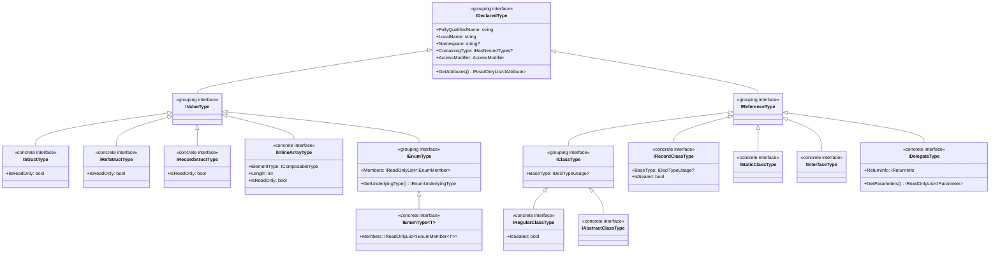

docs-unslop conformant.

# Rectaleaf Type System & Type Usage Architecture

This document provides a comprehensive structural guide to the two core interface hierarchies of the `Rectaleaf` metadata layer:
1. **The Declared Type Hierarchy (`IDeclaredType`)** represents C# type definitions and their members.
2. **The Type Usage Hierarchy (`ITypeUsage`)** represents wrappers around declared or predefined types that provide the context in which a type is used (e.g., `T[]` or `ref T`).

---

## 1. Declared Type Hierarchy (`IDeclaredType`)

The declared type hierarchy classifies type declarations so that consuming code can specify the exact shape of type metadata it expects to inspect. For example, by accepting `IStructType` as a parameter, a method forces callers to provide struct declaration metadata specifically, as opposed to an unconstrained `Type` (Reflection) or `INamedTypeSymbol` (Source Generators).

Some interfaces in the hierarchy are used for grouping, for example allowing both `IStructType` and `IRecordStructType` to be upcast to `IValueType`. These grouping interfaces should not be implemented directly. Backends should only implement concrete leaf interfaces such as `IStructType`.

---

### Detailed Capabilities & Implementation Role per Declared Type Node

| Type Node | Role | Capabilities & Traits Implemented | Unique Members / Notes |
| :--- | :---: | :--- | :--- |
| **`IDeclaredType`** | **Grouping** | *(Root Definition)* | `FullyQualifiedName`, `LocalName`, `Namespace`, `ContainingType`, `AccessModifier`, `GetAttributes()`. Base contract for all declared types. |
| **`IValueType`** | **Grouping** | `IDeclaredType` | Value-type root discrimination (`where T : struct`). |
| **`IReferenceType`** | **Grouping** | `IDeclaredType` | Reference-type root discrimination (`where T : class`). |
| **`IStructType`** | **Concrete** | `IValueType` • `IHasFields` • `IHasMethods` • `IHasProperties` • `IHasIndexers` • `IHasEvents` • `IHasGenericParameters` • `IHasInstanceConstructors` • `IHasStaticConstructor` • `IHasNestedTypes` • `IHasInterfaces` • `IHasOperators` | • `bool IsReadOnly { get; }` Represents a standard (non-ref) struct. |
| **`IRefStructType`** | **Concrete** | `IValueType` • `IHasFields` • `IHasMethods` • `IHasProperties` • `IHasIndexers` • `IHasEvents` • `IHasGenericParameters` • `IHasInstanceConstructors` • `IHasStaticConstructor` • `IHasNestedTypes` • `IHasInterfaces` • `IHasOperators` | • `bool IsReadOnly { get; }` Represents a stack-only `ref struct`. |
| **`IRecordStructType`** | **Concrete** | `IValueType` • `IHasFields` • `IHasMethods` • `IHasProperties` • `IHasIndexers` • `IHasEvents` • `IHasGenericParameters` • `IHasInstanceConstructors` • `IHasStaticConstructor` • `IHasNestedTypes` • `IHasInterfaces` • `IHasOperators` | • `bool IsReadOnly { get; }` Represents a `record struct`. |
| **`IInlineArrayType`** | **Concrete** | `IValueType` • `IHasMethods` • `IHasProperties` • `IHasIndexers` • `IHasEvents` • `IHasGenericParameters` • `IHasInstanceConstructors` • `IHasStaticConstructor` • `IHasNestedTypes` • `IHasInterfaces` • `IHasOperators` | • `IComposableType<IKnownOrNot> ElementType { get; }` • `int Length { get; }` • `bool IsReadOnly { get; }` *(Deliberately omits `IHasFields` to avoid exposing the synthetic private backing buffer field).* |
| **`IEnumType`** | **Grouping** | `IValueType` • `IHasNestedTypes` | • `IReadOnlyList<IEnumMember> Members { get; }` • `IEnumUnderlyingType GetUnderlyingType()` Base enum model. |
| **`IEnumType<T>`** | **Concrete** | `IEnumType` (`T : struct`) • `IHasNestedTypes` | • `new IReadOnlyList<IEnumMember<T>> Members { get; }` Strongly-typed enum definition with known underlying integer representation `T`. |
| **`IClassType`** | **Grouping** | `IReferenceType` • `IHasFields` • `IHasMethods` • `IHasProperties` • `IHasIndexers` • `IHasEvents` • `IHasGenericParameters` • `IHasInstanceConstructors` • `IHasStaticConstructor` • `IHasNestedTypes` • `IHasInterfaces` • `IHasOperators` • `IValidConstraint` | • `IDeclTypeUsage<IKnownOrNot, IClassType>? BaseType { get; }` Base interface for classes. |
| **`IRegularClassType`** | **Concrete** | `IClassType` *(all capabilities of `IClassType`)* | • `bool IsSealed { get; }` Standard instantiable class (non-abstract, non-static). |
| **`IAbstractClassType`** | **Concrete** | `IClassType` *(all capabilities of `IClassType`)* | Abstract class definition (cannot be sealed or directly instantiated). |
| **`IRecordClassType`** | **Concrete** | `IReferenceType` • `IHasFields` • `IHasMethods` • `IHasProperties` • `IHasIndexers` • `IHasEvents` • `IHasGenericParameters` • `IHasInstanceConstructors` • `IHasStaticConstructor` • `IHasNestedTypes` • `IHasInterfaces` • `IHasOperators` • `IValidConstraint` | • `IDeclTypeUsage<IKnownOrNot, IRecordClassType>? BaseType { get; }` • `bool IsSealed { get; }` Record class definition. |
| **`IStaticClassType`** | **Concrete** | `IReferenceType` • `IHasFields` • `IHasMethods` • `IHasProperties` • `IHasEvents` • `IHasGenericParameters` • `IHasStaticConstructor` • `IHasNestedTypes` • `IHasOperators` • `IHasExtensionsBlocks` | Represents a static class definition. *(Omits `IHasInstanceConstructors`, `IHasIndexers`, `IHasInterfaces`, and `IValidConstraint` since static classes cannot be instantiated, implement interfaces, or serve as generic constraints. Exposes C# 14 extension member blocks via `IHasExtensionsBlocks`).* |
| **`IInterfaceType`** | **Concrete** | `IReferenceType` • `IHasMethods` • `IHasProperties` • `IHasIndexers` • `IHasEvents` • `IHasGenericParameters` • `IHasStaticConstructor` • `IHasNestedTypes` • `IHasInterfaces` • `IHasOperators` • `IValidConstraint` | *(Omits `IHasFields` and `IHasInstanceConstructors`. Supports Default Interface Methods and static abstract/virtual members).* |
| **`IDelegateType`** | **Concrete** | `IReferenceType` • `IHasGenericParameters` • `IHasNestedTypes` | • `IReturnInfo<IKnownOrNot> ReturnInfo { get; }` • `IReadOnlyList<IParameter> GetParameters()` Represents a first-class callable delegate definition. |

---

## 2. Type Usage Hierarchy (`ITypeUsage`)

The `ITypeUsage` hierarchy represents how types are used in memory layouts, parameters, return types, etc. By-ref types are separated from other type usages at the root because they cannot be nested inside other wrappers (for example, arrays of by-ref types are prohibited in C#, so by-ref types cannot implement `IComposableType`).

```mermaid
classDiagram
    %% Roots
    class ITypeUsage_TKind_["ITypeUsage&lt;out TKind&gt;"] {
        <<grouping interface>>
        +LocalName: string
    }

    class IByRefType_TKind_TMut_["IByRefType&lt;out TKind, out TMutability&gt;"] {
        <<concrete interface>>
        +ElementType: IComposableType
    }

    class IComposableType_TKind_["IComposableType&lt;out TKind&gt;"] {
        <<grouping interface>>
    }

    ITypeUsage_TKind_ <|-- IByRefType_TKind_TMut_
    ITypeUsage_TKind_ <|-- IComposableType_TKind_

    %% Wrappers
    class IWrapperType_TKind_["IWrapperType&lt;out TKind&gt;"] {
        <<grouping interface>>
        +ElementType: IComposableType
    }
    class IPointerType_TKind_["IPointerType&lt;out TKind&gt;"] {
        <<concrete interface>>
    }
    class IArrayType_TKind_TRank_["IArrayType&lt;out TKind, out TRankKind&gt;"] {
        <<concrete interface>>
        +Rank: int
        +Nullability: NullabilityKind
    }

    IComposableType_TKind_ <|-- IWrapperType_TKind_
    IWrapperType_TKind_ <|-- IPointerType_TKind_
    IWrapperType_TKind_ <|-- IArrayType_TKind_TRank_

    %% Inner Types
    class IInnerType_TKind_["IInnerType&lt;out TKind&gt;"] {
        <<grouping interface>>
    }

    IComposableType_TKind_ <|-- IInnerType_TKind_

    %% Predefined Primitive Inner Types
    class IPredefinedType {
        <<concrete interface>>
        +Kind: PredefinedTypeKind
        +Nullability: NullabilityKind
    }
    class IFixedSizeBufferType {
        <<concrete interface>>
        +Kind: FixedSizeBufferTypeEnum
    }
    class IEnumUnderlyingType {
        <<concrete interface>>
        +Kind: EnumUnderlyingTypeEnum
    }

    IInnerType_TKind_ <|-- IPredefinedType
    IInnerType_TKind_ <|-- IFixedSizeBufferType
    IInnerType_TKind_ <|-- IEnumUnderlyingType

    %% Declared Type Usages
    class IDeclTypeUsage_TKind_["IDeclTypeUsage&lt;out TKind&gt;"] {
        <<grouping interface>>
        +TypeDefinition: IDeclaredType
        +Nullability: NullabilityKind
    }
    class IDeclTypeUsage_TKind_TDecl_["IDeclTypeUsage&lt;out TKind, out TDecl&gt;"] {
        <<grouping interface>>
        +TypeDefinition: TDecl
    }
    class IPlainType_TDecl_["IPlainType&lt;out TDecl&gt;"] {
        <<concrete interface>>
    }
    class IBoundGenericType_TKind_TDecl_["IBoundGenericType&lt;out TKind, out TDecl&gt;"] {
        <<concrete interface>>
        +TypeArguments: IReadOnlyList
    }

    IInnerType_TKind_ <|-- IDeclTypeUsage_TKind_
    IDeclTypeUsage_TKind_ <|-- IDeclTypeUsage_TKind_TDecl_
    IDeclTypeUsage_TKind_TDecl_ <|-- IPlainType_TDecl_
    IDeclTypeUsage_TKind_TDecl_ <|-- IBoundGenericType_TKind_TDecl_

    %% Placeholders
    class IPlaceholderType {
        <<concrete interface>>
        +Info: IGenericParameter
        +Nullability: NullabilityKind
    }
    IInnerType_TKind_ <|-- IPlaceholderType

    %% Function Pointers
    class IFunctionPointerType_TKind_["IFunctionPointerType&lt;out TKind&gt;"] {
        <<grouping interface>>
        +ReturnType: ITypeUsage
        +Parameters: IReadOnlyList~IParameter~
    }
    class IManagedFunctionPointerType_TKind_["IManagedFunctionPointerType&lt;out TKind&gt;"] {
        <<concrete interface>>
    }
    class IUnmanagedFunctionPointerType_TKind_["IUnmanagedFunctionPointerType&lt;out TKind&gt;"] {
        <<concrete interface>>
        +CallingConventions: IReadOnlyList~CallConvKind~
        +CallingConventionFlags: CallConvFlags
    }

    IInnerType_TKind_ <|-- IFunctionPointerType_TKind_
    IFunctionPointerType_TKind_ <|-- IManagedFunctionPointerType_TKind_
    IFunctionPointerType_TKind_ <|-- IUnmanagedFunctionPointerType_TKind_

    %% Tuples
    class ITupleType_TKind_["ITupleType&lt;out TKind&gt;"] {
        <<grouping interface>>
        +UnderlyingValueTupleType: IBoundGenericType
        +Nullability: NullabilityKind
        +GetElementTypes(): IReadOnlyList~IComposableType~
    }
    class IRichTupleType_TKind_["IRichTupleType&lt;out TKind&gt;"] {
        <<concrete interface>>
        +Elements: IReadOnlyList~ITupleElement~
    }
    class IExplicitValueTupleType_TKind_["IExplicitValueTupleType&lt;out TKind&gt;"] {
        <<concrete interface>>
    }
    class IObliviousTupleType_TKind_["IObliviousTupleType&lt;out TKind&gt;"] {
        <<concrete interface>>
    }

    IInnerType_TKind_ <|-- ITupleType_TKind_
    ITupleType_TKind_ <|-- IRichTupleType_TKind_
    ITupleType_TKind_ <|-- IExplicitValueTupleType_TKind_
    ITupleType_TKind_ <|-- IObliviousTupleType_TKind_
```

---

### Detailed Implementation Roles & Contracts per Type Usage Node

| Type Usage Interface | Role | Inherited From | Members & Semantic Description |
| :--- | :---: | :--- | :--- |
| **`ITypeUsage<out TKind>`** | **Grouping** | *(Root)* | `LocalName`. Root of all type representations (`TKind : IKnownOrNot`). |
| **`IByRefType<out TKind, out TMutability>`** | **Concrete** | `ITypeUsage<TKind>` | • `IComposableType<TKind> ElementType { get; }` Top-level by-ref wrapper (`ref` and `out` via `IMut`, `ref readonly` and `in` via `IReadOnly`). Used for by-ref returns, by-ref properties/indexers, `ref` fields, and parameters with `ref`, `out`, `in`, or `ref readonly` modifiers. Cannot be nested inside arrays, pointers, or type arguments. |
| **`IComposableType<out TKind>`** | **Grouping** | `ITypeUsage<TKind>` | Root for all types that can compose arrays, pointers, type arguments, and tuples. |
| **`IWrapperType<out TKind>`** | **Grouping** | `IComposableType<TKind>` | • `IComposableType<TKind> ElementType { get; }` Base for wrapping composable types. |
| **`IPointerType<out TKind>`** | **Concrete** | `IWrapperType<TKind>` | Represents unmanaged pointers (`T*`, `void*`). |
| **`IArrayType<out TKind, out TRankKind>`** | **Concrete** | `IWrapperType<TKind>` • `IHasNullability` | • `int Rank { get; }` • `NullabilityKind Nullability { get; }` Represents single-dimensional linear arrays (`IFlat`, `T[]`) and multidimensional rectangular arrays (`IRectArr`, `T[,]`, `T[,,]`). |
| **`IInnerType<out TKind>`** | **Grouping** | `IComposableType<TKind>` | Base for all leaf and inner non-wrapper composable types. |
| **`IPredefinedType`** | **Concrete** | `IInnerType<IKnown>` • `IHasNullability` | • `PredefinedTypeKind Kind { get; }` • `NullabilityKind Nullability { get; }` Represents built-in language primitives (`int`, `string`, `bool`, `void`, `object`, etc.). |
| **`IFixedSizeBufferType`** | **Concrete** | `IInnerType<IKnown>` | • `FixedSizeBufferTypeEnum Kind { get; }` Represents valid fixed-size buffer underlying element types (`int`, `byte`, `char`, etc.). |
| **`IEnumUnderlyingType`** | **Concrete** | `IInnerType<IKnown>` | • `EnumUnderlyingTypeEnum Kind { get; }` Represents underlying integer storage types for enums (`byte`, `sbyte`, `short`, `ushort`, `int`, `uint`, `long`, `ulong`). |
| **`IDeclTypeUsage<out TKind>`** | **Grouping** | `IInnerType<TKind>` • `IHasNullability` | • `IDeclaredType TypeDefinition { get; }` Shortcut interface for usages of any declared type. *(Do not implement directly; implement `IPlainType` or `IBoundGenericType`).* |
| **`IDeclTypeUsage<out TKind, out TDecl>`** | **Grouping** | `IDeclTypeUsage<TKind>` | • `new TDecl TypeDefinition { get; }` Strongly-typed usage of `TDecl : IDeclaredType`. |
| **`IPlainType<out TDecl>`** | **Concrete** | `IDeclTypeUsage<IKnown, TDecl>` | Represents a non-generic declared type usage (e.g. `MyClass _item = new();`). Always `IKnown`. |
| **`IBoundGenericType<out TKind, out TDecl>`** | **Concrete** | `IDeclTypeUsage<TKind, TDecl>` | • `IReadOnlyList<IComposableType<IKnownOrNot>> TypeArguments { get; }` Represents closed or open generic bindings (e.g. `List<int>`, `Dictionary<TKey, TValue>`). |
| **`IPlaceholderType`** | **Concrete** | `IInnerType<IIncomplete>` • `IHasNullability` | • `IGenericParameter Info { get; }` Represents a generic type parameter usage (e.g. `T`, `TItem`), linking back to its declaring entity and constraint metadata. |
| **`IFunctionPointerType<out TKind>`** | **Grouping** | `IInnerType<TKind>` | • `ITypeUsage<TKind> ReturnType { get; }` • `IReadOnlyList<IParameter> Parameters { get; }` Base for function pointer type usages (`delegate*`). |
| **`IManagedFunctionPointerType<out TKind>`** | **Concrete** | `IFunctionPointerType<TKind>` | Represents standard managed function pointers (`delegate*<int, void>`). |
| **`IUnmanagedFunctionPointerType<out TKind>`** | **Concrete** | `IFunctionPointerType<TKind>` | • `IReadOnlyList<CallConvKind> CallingConventions { get; }` • `CallConvFlags CallingConventionFlags { get; }` Represents unmanaged function pointers with explicit or implicit calling conventions (`delegate* unmanaged[Cdecl]<int, void>`). |
| **`ITupleType<out TKind>`** | **Grouping** | `IInnerType<TKind>` • `IHasNullability` | • `IBoundGenericType<TKind, IStructType> UnderlyingValueTupleType { get; }` • `IReadOnlyList<IComposableType<IKnownOrNot>> ElementTypesMixed { get; }` (accessible via `GetElementTypes()` extension method). Base interface for all tuple representations (`ValueTuple`). Exposes the unflattened collection of element types. |
| **`IRichTupleType<out TKind>`** | **Concrete** | `ITupleType<TKind>` | • `IReadOnlyList<ITupleElement<TKind>> Elements { get; }` Represents a rich tuple created via tuple syntax with explicit or optional element names (e.g. `(int Code, string Message)`). |
| **`IExplicitValueTupleType<out TKind>`** | **Concrete** | `ITupleType<TKind>` | Represents a tuple created via explicit generic `ValueTuple<...>` chain syntax in source code. |
| **`IObliviousTupleType<out TKind>`** | **Concrete** | `ITupleType<TKind>` | Represents a tuple from metadata/reflection where source syntax disambiguation is unknown. |

### Notes
* Nullability is attached directly to individual type usage models via `IHasNullability` instead of modeling it with a dedicated type usage wrapper. All `Nullable<T>` are unwrapped to the model of `T` with nullability set to `NullabilityKind.Nullable`.
* On `ITypeUsage`, `LocalName` (as well as the `FullyQualifiedName` extension property on `ITypeUsage<IKnown>` and `MaxName` on `ITypeUsage<IIncomplete>`) includes all usage annotations such as `?` (when `Nullability` is `NullabilityKind.Nullable`), `*`, `[]`, `[,]`, `ref`, and `ref readonly` via `WrapperNameFormatter`. On `IDeclaredType` (such as `IDeclTypeUsage.TypeDefinition`), `LocalName` and `FullyQualifiedName` represent the type declaration itself without usage-site `?`, `*`, `[]`, or `ref` annotations.

---

## 3. Implementation Rules for Backends

### 1. Grouping Interfaces vs. Concrete Implementations
* **Do not implement grouping interfaces directly:** Types like `IClassType`, `IValueType`, `IReferenceType`, `IDeclTypeUsage`, `IInnerType`, `IWrapperType`, `IFunctionPointerType`, and `ITupleType` exist purely for category polymorphism and pattern matching.
* **Implement concrete interfaces:** In their model factory methods, backends must instantiate leaf implementations (`IRegularClassType`, `IAbstractClassType`, `IRecordClassType`, `IStructType`, `IPlainType`, `IBoundGenericType`, `IRichTupleType`, `IExplicitValueTupleType`, `IObliviousTupleType`, `IManagedFunctionPointerType`, `IUnmanagedFunctionPointerType`, etc.).

### 2. Common Type Usage Implementations
To minimize duplicate backend work, all type usage implementations (`ArrayType`, `PointerType`, `PlainType`, `BoundGenericType`, `PlaceholderType`, `PredefinedType`, `FixedSizeBufferType`, `EnumUnderlyingType`, `RichTupleType`, `ChainTupleType`, `ManagedFunctionPointerType`, `UnmanagedFunctionPointerType`) are provided in the `Rectaleaf.Metadata.TypeUsages.CommonTypeUsageImpl` namespace.
* Backends only need to instantiate common implementations and focus on declared type models and member extraction.
* Backends can still write their own custom implementations and upcast them to the interface type so that consuming code can benefit from backend-specific optimizations (for example, the Roslyn backend can implement special capability interfaces like `IFastGenericArity` on its custom implementations to allow consuming code to retrieve generic arity directly without enumerating generic parameters).
